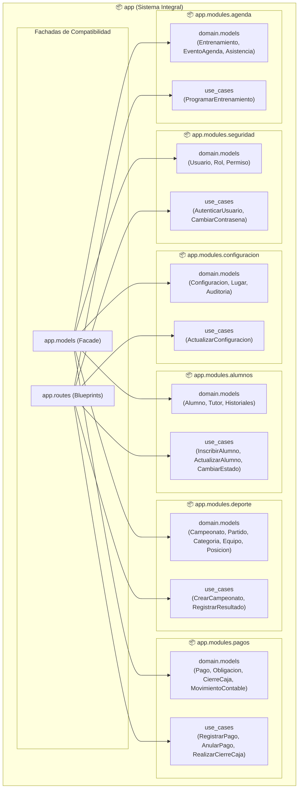
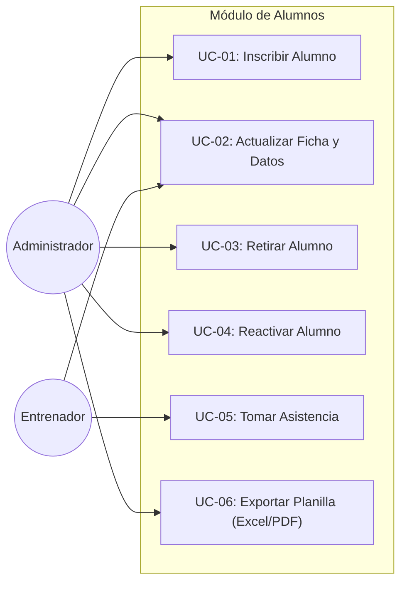
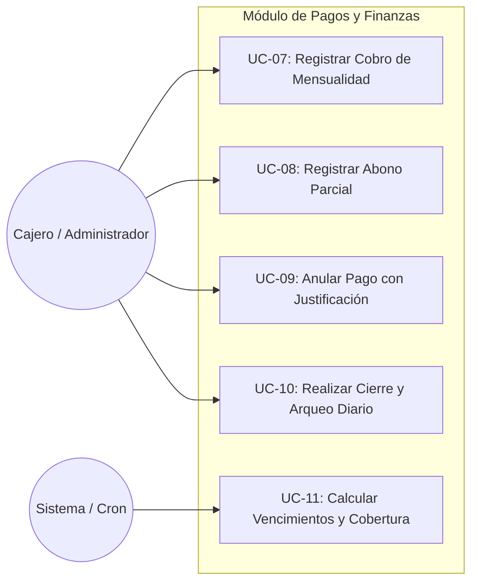
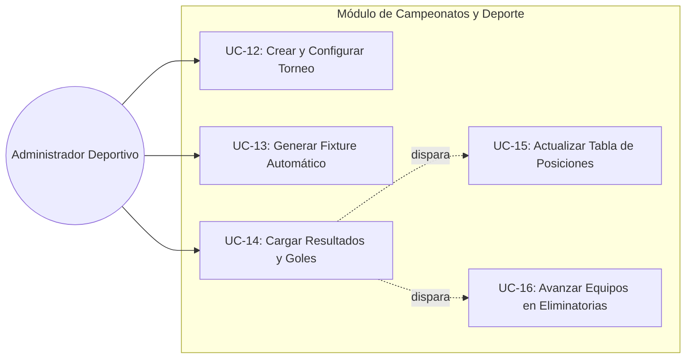
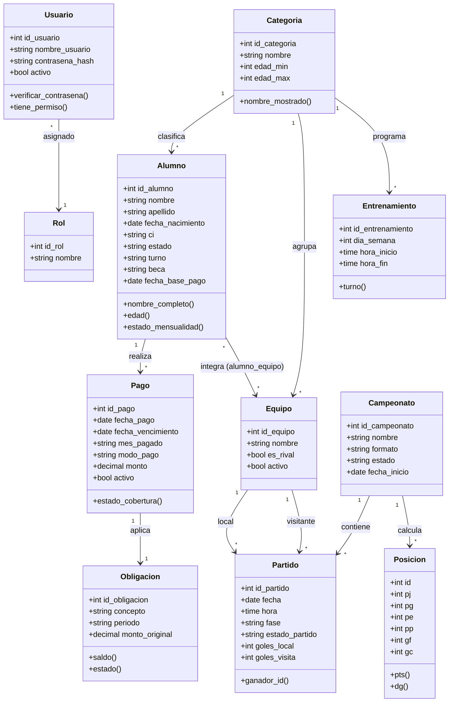

# 🏛️ Documentación de Arquitectura Modular y Diagramas UML

Este documento describe la refactorización arquitectónica de la aplicación **Academia de Fútbol**, estructurada bajo el patrón **Modular por Dominios (Bounded Contexts)** y **Casos de Uso (Clean Architecture)**.

---

## 📐 1. Diagrama de Paquetes UML (Package Diagram)

La aplicación organiza sus responsabilidades en 6 paquetes de dominio principales. Cada paquete encapsula su capa de **Dominio (`domain`)**, **Casos de Uso (`use_cases`)** y **Controladores / Rutas (`controllers/routes`)**.

---

## 🎯 2. Diagramas de Casos de Uso UML (Use Case Diagrams)

### A. Casos de Uso: Gestión de Plantel y Alumnos

### B. Casos de Uso: Tesorería y Cobranzas

### C. Casos de Uso: Torneos, Fixtures y Partidos

---

## 📊 3. Diagrama de Clases UML del Dominio (Class Diagram)

---

## 🚀 4. Ventajas de la Nueva Estructura Modular

1. **Separación de Responsabilidades:** La lógica de negocio ya no se encuentra dispersa en archivos gigantescos de más de 1,400 líneas, sino en clases de Casos de Uso atómicas y testeables (`InscribirAlumnoUseCase`, `RegistrarPagoUseCase`, etc.).
2. **Cero Rotura (100% Backward Compatible):** El archivo `app/models.py` funciona como un patrón **Facade**, garantizando que cualquier llamada o consulta existente (`from app.models import Alumno, Pago...`) continúe funcionando de forma transparente.
3. **Escalabilidad para Microservicios o APIs:** Cada subpaquete en `app/modules/*` puede ser expuesto fácilmente vía API REST, GraphQL o transformado en un microservicio si el proyecto escala a futuro.
