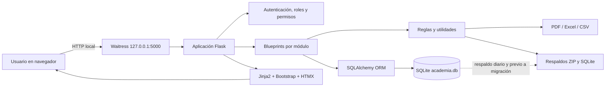
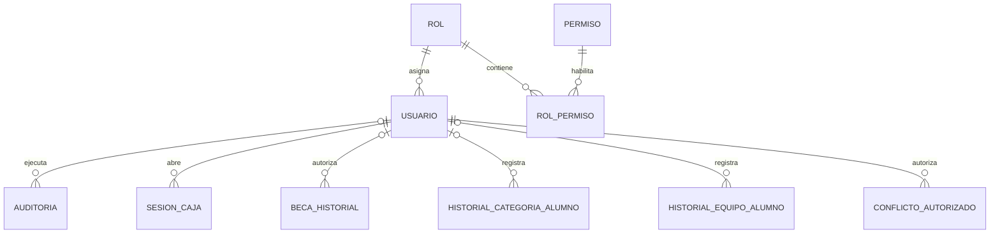
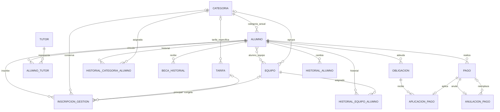
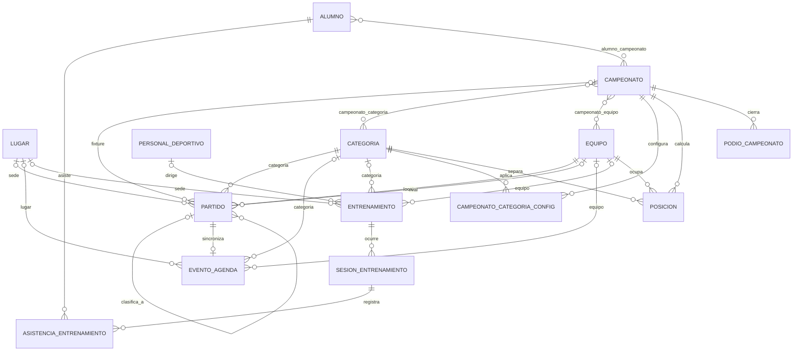
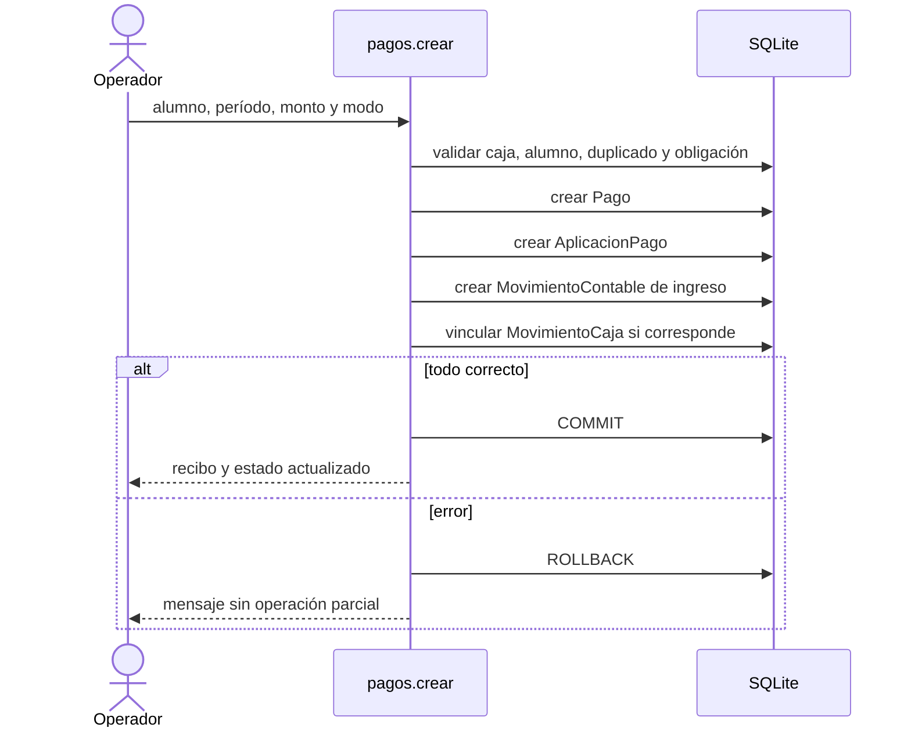
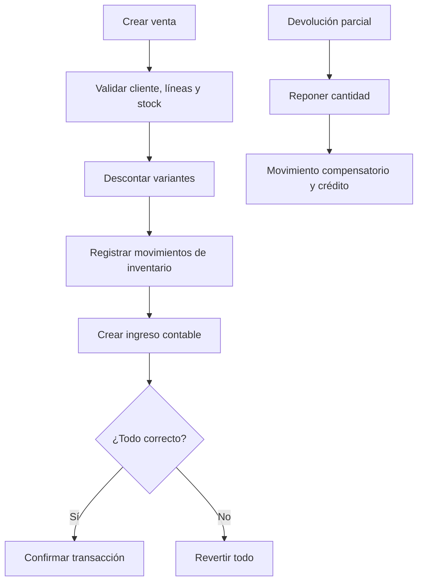
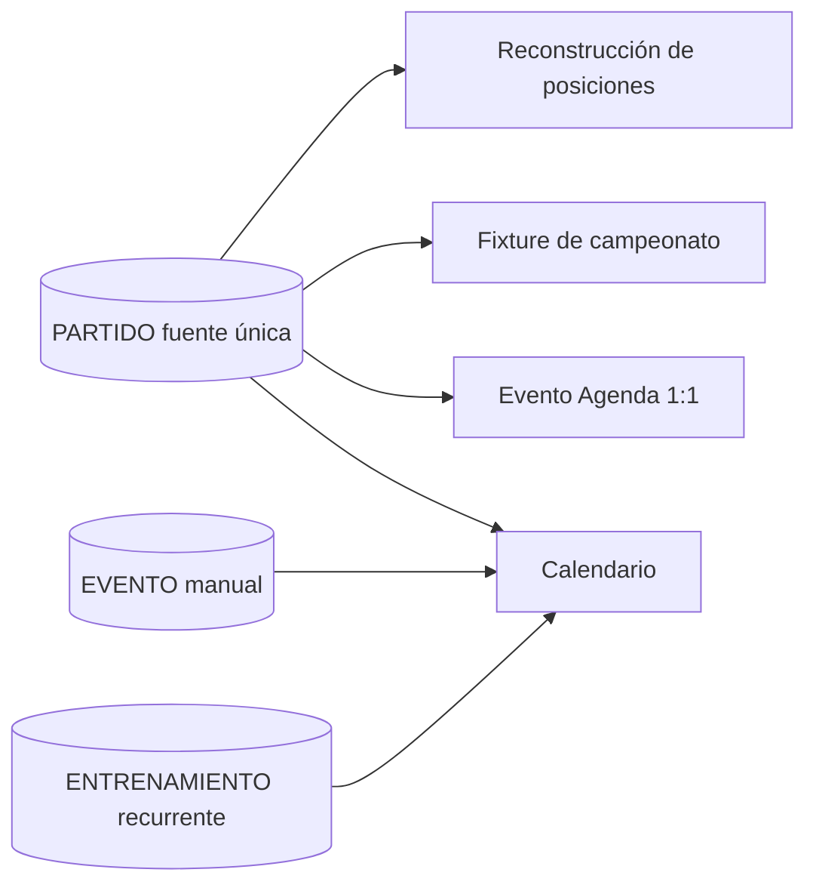

# Documentación técnica completa

Sistema de Gestión de Academias Deportivas  
Estado documentado: 16 de agosto de 2026  
Rama: `desarrollo`  
Esquema de base de datos: migraciones internas 1–30

Documento complementario: [catálogo completo de rutas HTTP](CATALOGO_RUTAS.md).

## 1. Propósito y alcance

Aplicación web local para administrar una academia deportiva sin depender de Internet. Centraliza alumnos, tutores, categorías, equipos, inscripciones, mensualidades, caja, finanzas, inventario, compras, ventas, partidos, agenda, calendario, entrenamientos, asistencia, campeonatos, usuarios, permisos, auditoría, documentos y respaldos.

El despliegue principal es Windows de 64 bits. La interfaz se abre en el navegador, pero el servidor, la base, los recursos CSS/JavaScript y los documentos permanecen en el equipo local.

### Principios de diseño

- Operación offline sobre `127.0.0.1`.
- Persistencia SQLite fuera del ejecutable instalado.
- Aplicación monolítica modular basada en Flask y blueprints.
- Renderizado HTML en servidor con Jinja2.
- Mejoras parciales con HTMX y JavaScript nativo.
- Integridad por claves, restricciones, índices, transacciones y auditoría.
- Conservación histórica mediante estados, anulaciones y borrado lógico.
- Migraciones idempotentes con respaldo obligatorio previo.

## 2. Tecnologías

| Capa | Tecnología | Uso |
|---|---|---|
| Lenguaje | Python 3.10+ | Backend, scripts y generación documental |
| Framework | Flask 3.1.3 | Aplicación HTTP y blueprints |
| ORM | Flask-SQLAlchemy 3.1.1 | Modelos, consultas y transacciones |
| Base | SQLite | Persistencia local principal |
| Formularios/CSRF | Flask-WTF 1.2.1, WTForms 3.1.2 | Protección de solicitudes mutables |
| Servidor | Waitress 3.0.2 | Ejecución diaria con cuatro hilos |
| Interfaz | Jinja2, Bootstrap local, Bootstrap Icons | Renderizado y componentes visuales |
| Interacción | HTMX local y JavaScript nativo | Filtros, fragmentos, descargas y formularios |
| Excel | openpyxl 3.1.5 | Exportaciones XLSX |
| PDF | ReportLab 4.2.5 | Fichas, recibos, calendarios y reportes |
| Fechas | python-dateutil 2.9 | Cálculos mensuales |
| Pruebas | pytest 9.1.1 | Pruebas funcionales e integración |
| Empaquetado | PyInstaller 6.21 | Ejecutable de escritorio |
| Instalador | Inno Setup | Instalación y accesos directos Windows |

No se cargan CDN, fuentes, scripts ni servicios bancarios externos. Los enlaces de Google Maps se almacenan como texto y únicamente se abren si el operador decide utilizarlos con conexión disponible.

## 3. Arquitectura general



### Flujo de una solicitud

1. Waitress recibe la solicitud local.
2. `before_request` comprueba respaldo diario, autenticación, cambio obligatorio de clave y permiso requerido.
3. El blueprint valida parámetros y reglas de negocio.
4. SQLAlchemy consulta o modifica SQLite.
5. La operación completa confirma con `commit`; ante fallo debe ejecutar `rollback`.
6. Flask devuelve HTML, fragmento HTMX, archivo o redirección con mensaje.
7. `after_request` agrega encabezados de seguridad y evita caché de datos privados.

## 4. Estructura del repositorio

```text
academia_futbol/
├── app/
│   ├── __init__.py                 fábrica de aplicación, middleware y semillas
│   ├── extensions.py               SQLAlchemy, CSRF y PRAGMA de SQLite
│   ├── migrations.py               migraciones internas 1–30
│   ├── models.py                   modelos y eventos SQLAlchemy
│   ├── routes/                     controladores organizados por blueprint
│   ├── templates/                  vistas Jinja2
│   ├── static/css/estilos.css      tema y diseño adaptable
│   ├── static/vendor/              Bootstrap, iconos y HTMX locales
│   └── utils/                      autorización, backups, PDF, Excel y reglas
├── instance/                       datos locales en desarrollo; no versionar
├── scripts/                        backup, restore, mantenimiento y datos demo
├── tests/                          pruebas automáticas
├── installer/                      definición del instalador Windows
├── config.py                       configuración y rutas persistentes
├── run.py                          servidor Flask de desarrollo
├── serve.py                        servidor Waitress para uso diario
├── desktop.py                      entrada del ejecutable instalado
├── AcademiaFutbol.spec             construcción PyInstaller
└── requirements*.txt               dependencias de producción y desarrollo
```

## 5. Ejecución y despliegue

### Desarrollo

```powershell
cd C:\Users\MarceloPC\Downloads\academia_futbol\academia_futbol
.\venv\Scripts\Activate.ps1
python run.py
```

`FLASK_DEBUG=1` habilita depuración explícitamente. La URL es `http://127.0.0.1:5000`.

### Uso diario desde código

```powershell
.\venv\Scripts\Activate.ps1
python serve.py
```

### Aplicación instalada

`desktop.py` comprueba el puerto, inicia Waitress y abre el navegador. `ACADEMIA_NO_BROWSER` evita la apertura automática y `ACADEMIA_PORT` cambia el puerto.

PyInstaller copia plantillas y recursos estáticos al paquete `AcademiaFutbol`. Inno Setup instala sin privilegios administrativos en `%LOCALAPPDATA%\Programs\GestionAcademiaDeportiva`. La desinstalación elimina el programa, pero conserva los datos.

## 6. Configuración y almacenamiento

| Variable/opción | Predeterminado | Descripción |
|---|---|---|
| `ACADEMIA_DATA_DIR` | `instance/` o `%LOCALAPPDATA%\GestionAcademiaDeportiva` | Raíz persistente |
| `DATABASE_URL` | `sqlite:///.../academia.db` | Conexión SQLAlchemy |
| `SECRET_KEY` | archivo `.secret_key` | Firma de sesión y CSRF |
| `ACADEMIA_PORT` | `5000` | Puerto del ejecutable |
| `ACADEMIA_NO_BROWSER` | vacío | No abrir navegador automáticamente |
| `FLASK_DEBUG` | desactivado | Depuración en `run.py` |
| `AUTH_REQUIRED` | `True` | Exige autenticación |
| `AUTO_BACKUP` | `True` | Respaldo diario |
| `BACKUP_RETENTION_DAYS` | `30` | Retención automática |
| `MAX_CONTENT_LENGTH` | 8 MiB | Límite de fotografía/documento |
| `ITEMS_PER_PAGE` | 40 | Paginación general |

### Directorios persistentes

```text
GestionAcademiaDeportiva/
├── academia.db
├── .secret_key
├── backups/
├── branding/
├── comprobantes/
├── Descargas/
├── logs/academia.log
└── uploads/alumnos/
```

En código fuente, la raíz es `instance/`. En el ejecutable instalado, es `%LOCALAPPDATA%\GestionAcademiaDeportiva`, de modo que actualizar o desinstalar el binario no elimina datos.

## 7. Base de datos

### Configuración SQLite

En cada conexión se ejecuta:

- `PRAGMA foreign_keys = ON`: aplica claves foráneas.
- `PRAGMA busy_timeout = 5000`: espera hasta cinco segundos ante bloqueo.
- `PRAGMA journal_mode = WAL`: mejora lectura concurrente y consistencia local.
- `pool_pre_ping`: descarta conexiones inválidas.

SQLite es apropiado para una instalación offline en un solo equipo. No debe copiarse `academia.db` mientras hay escrituras sin usar el mecanismo de respaldo consistente.

### Convenciones

- Las claves primarias son enteros `id_*`.
- Los importes son `NUMERIC(10,2)` o `NUMERIC(12,2)`.
- Las fechas se guardan como `DATE`; horas como `TIME`; auditoría como `DATETIME`.
- `activo`, `estado`, `anulado_en`, `eliminado_en` y fechas de cierre preservan el historial.
- Relaciones polimórficas `origen_tipo/origen_id` enlazan finanzas e inventario con la operación origen sin una FK única posible.
- Tablas puente con PK compuesta: `rol_permiso`, `alumno_equipo`, `campeonato_categoria`, `campeonato_equipo` y `alumno_campeonato`.

## 8. Diagramas entidad–relación

Los diagramas representan las relaciones persistidas. Las relaciones polimórficas se muestran punteadas porque SQLite no puede imponer una FK hacia varias tablas.

### 8.1 Seguridad y auditoría



### 8.2 Alumnos, ciclos y mensualidades



### 8.3 Caja, contabilidad y pagos programados

```mermaid
erDiagram
    USUARIO ||--o{ SESION_CAJA : opera
    CIERRE_CAJA o|--o| SESION_CAJA : legado
    SESION_CAJA ||--o{ MOVIMIENTO_CAJA : contiene
    MOVIMIENTO_CONTABLE ||--o| MOVIMIENTO_CAJA : refleja
    CATEGORIA_CONTABLE o|--o{ MOVIMIENTO_CONTABLE : clasifica
    PROVEEDOR o|--o{ MOVIMIENTO_CONTABLE : contraparte
    CATEGORIA_CONTABLE o|--o{ PAGO_PROGRAMADO : clasifica
    PROVEEDOR o|--o{ PAGO_PROGRAMADO : beneficiario
    PAGO_PROGRAMADO ||--o{ CUOTA_PROGRAMADA : genera
    MOVIMIENTO_CONTABLE o|--o| CUOTA_PROGRAMADA : paga
    PAGO -.-> MOVIMIENTO_CONTABLE : origina
    VENTA -.-> MOVIMIENTO_CONTABLE : origina
    COMPRA -.-> MOVIMIENTO_CONTABLE : origina
```

### 8.4 Inventario, compras, ventas y devoluciones

```mermaid
erDiagram
    PRODUCTO ||--o{ PRODUCTO_VARIANTE : ofrece
    PRODUCTO_VARIANTE ||--o{ MOVIMIENTO_INVENTARIO : registra
    PROVEEDOR ||--o{ COMPRA : suministra
    COMPRA ||--|{ DETALLE_COMPRA : contiene
    PRODUCTO_VARIANTE ||--o{ DETALLE_COMPRA : recibe
    ALUMNO o|--o{ VENTA : compra
    VENTA ||--|{ DETALLE_VENTA : contiene
    PRODUCTO_VARIANTE ||--o{ DETALLE_VENTA : vende
    VENTA ||--o{ DEVOLUCION_VENTA : admite
    DEVOLUCION_VENTA ||--|{ DETALLE_DEVOLUCION_VENTA : contiene
    DETALLE_VENTA ||--o{ DETALLE_DEVOLUCION_VENTA : devuelve
    CONTEO_INVENTARIO ||--|{ DETALLE_CONTEO_INVENTARIO : compara
    PRODUCTO_VARIANTE ||--o{ DETALLE_CONTEO_INVENTARIO : cuenta
    COMPRA -.-> MOVIMIENTO_INVENTARIO : entrada
    VENTA -.-> MOVIMIENTO_INVENTARIO : salida
    DEVOLUCION_VENTA -.-> MOVIMIENTO_INVENTARIO : restitucion
```

### 8.5 Operación deportiva



## 9. Diccionario de datos

Leyenda: `PK` clave primaria, `FK` clave foránea, `UQ` único, `NN` obligatorio. Los campos históricos de texto junto a una FK se conservan para que renombrar un catálogo no reescriba el significado mostrado en documentos antiguos.

### 9.1 Seguridad, configuración y auditoría

- `permiso`: `id_permiso PK`, `codigo UQ NN`, `nombre NN`.
- `rol`: `id_rol PK`, `nombre UQ NN`, `descripcion`.
- `rol_permiso`: `id_rol PK/FK`, `id_permiso PK/FK`.
- `usuario`: `id_usuario PK`, `nombre_usuario UQ NN`, `nombre_completo NN`, `contrasena_hash NN`, `id_rol FK NN`, `activo NN`, `debe_cambiar_clave NN`, `ultimo_acceso`, `creado_en NN`.
- `configuracion`: `id PK`, `monto_mensualidad`, datos de academia, moneda, tolerancia de vencimiento, walkover, gestión de ficha, eslogan, logo, tres colores y `contrasena_hash` legado.
- `auditoria`: `id_auditoria PK`, módulo, acción, entidad, ID de entidad, detalle, `id_usuario FK`, valores anterior/nuevo y fecha.
- `schema_migration`: `version PK`, `nombre NN`, `aplicada_en NN`.

Las contraseñas se almacenan mediante hash Werkzeug, nunca en texto claro. `configuracion.contrasena_hash` existe por compatibilidad con el acceso antiguo; la autenticación actual utiliza `usuario.contrasena_hash`.

### 9.2 Personas, alumnos y ciclos

- `categoria`: `id_categoria PK`, `nombre UQ NN`, `edad_min`, `edad_max`.
- `equipo`: `id_equipo PK`, `nombre NN`, `id_categoria FK`, `es_rival NN`, `activo NN`; nombre/categoría/tipo forman identidad lógica.
- `alumno`: identidad, categoría actual, bandera manual, foto privada, nacimiento, CI, dirección, dos tutores legados, teléfono, estado, posición, pierna, medidas, sexo, beca vigente, fin de beca, ciclo de pago, fechas de reactivación/retiro y creación.
- `alumno_equipo`: `id_alumno PK/FK`, `id_equipo PK/FK`; representa pertenencia vigente rápida.
- `tutor`: `id_tutor PK`, nombre, documento, teléfono, correo, dirección y activo.
- `alumno_tutor`: `id_alumno_tutor PK`, alumno/tutor FK, parentesco, principal y autorización de recogida; UQ alumno+tutor.
- `inscripcion_gestion`: alumno y gestión UQ, fechas, estado, categoría, equipo principal, tarifa, monto congelado, porcentaje de beca, observación y creación.
- `historial_categoria_alumno`: alumno, categoría, intervalo, asignación automática/manual, motivo, bloqueo temporal, usuario actor y marca de migración aproximada.
- `historial_equipo_alumno`: alumno, equipo, gestión, intervalo, estado, salida, equipo principal, actor y marca de migración.
- `historial_alumno`: alumno, tipo de cambio, valor anterior/nuevo, motivo y fecha.
- `beca_historial`: alumno, porcentaje 0–100, vigencia, motivo, autorizador, estado, usuario actor y fecha.
- `tarifa`: concepto, monto, vigencia, categoría opcional, activo y creación.

### 9.3 Obligaciones, pagos y caja

- `obligacion`: alumno, concepto, período `YYYY-MM`, monto original, descuento, recargo, beca, vencimiento y creación; UQ alumno+concepto+período.
- `pago`: alumno, beca, pago, hora, vencimiento, período, modo, monto, creación, borrado lógico y operación.
- `aplicacion_pago`: obligación FK, pago FK único, monto aplicado y creación. Permite abonos y desacopla deuda de cobro.
- `anulacion_pago`: pago FK único, motivo, fecha y pago reemplazo opcional.
- `cierre_caja`: resumen diario legado por fecha, efectivo/QR del sistema y contado, diferencia, observación, cierre y reapertura.
- `sesion_caja`: usuario, apertura, saldo inicial, cierre, efectivo esperado/contado, diferencia, estado, observaciones, reapertura y vínculo legado UQ.
- `movimiento_caja`: sesión, movimiento contable UQ, tipo, monto, modo y fecha.

Un pago anulado permanece en `pago`; `eliminado_en` y `anulacion_pago` lo excluyen de ingresos y cobertura. Una beca completa cubre la obligación sin fingir una anulación.

### 9.4 Finanzas y recurrencias

- `categoria_contable`: nombre UQ, tipo `Ingreso/Egreso/Ambos`, activo y creación.
- `proveedor`: nombre UQ, tipo de persona, documento, correo, contacto, teléfono, dirección, observación y activo.
- `movimiento_contable`: sesión, tipo, categoría histórica y FK, concepto, monto, fecha, modo, operación, proveedor, comprobante, observación, origen polimórfico, anulación y creación.
- `pago_programado`: concepto, categoría histórica/FK, monto, proveedor, modo, frecuencia, intervalo o día mensual, vigencia, próxima fecha, observación, activo y creación.
- `cuota_programada`: programación, vencimiento, monto, estado, fecha de pago, movimiento contable UQ, omisión y creación; UQ programación+fecha.

La programación genera obligaciones futuras, no egresos. El egreso nace cuando una cuota se marca pagada.

### 9.5 Inventario y comercio

- `producto`: código UQ, nombre, categoría, descripción, activo y creación.
- `producto_variante`: producto, talla, color, compra, venta, stock y mínimo; UQ producto+talla+color.
- `movimiento_inventario`: variante, tipo, cantidad con signo, stock anterior/nuevo, motivo, origen polimórfico y fecha.
- `conteo_inventario`: fecha, estado, observación y creación.
- `detalle_conteo_inventario`: conteo, variante, stock del sistema y contado; UQ conteo+variante.
- `compra`: proveedor, fecha, factura, modo, total, observación, anulación y creación.
- `detalle_compra`: compra, variante, cantidad, costo y subtotal.
- `venta`: alumno o cliente externo, fecha, modo, operación, subtotal, descuento, total, observación, anulación y creación.
- `detalle_venta`: venta, variante, cantidad, precio y subtotal.
- `devolucion_venta`: venta, fecha, tipo, crédito, motivo y creación.
- `detalle_devolucion_venta`: devolución, línea de venta, cantidad y subtotal.

Compras incrementan stock y crean egreso; ventas reducen stock y crean ingreso; anulaciones/devoluciones revierten mediante movimientos compensatorios dentro de una transacción.

### 9.6 Agenda, entrenamiento y asistencia

- `lugar`: nombre UQ, tipo, dirección, URL de Maps, capacidad, superficie y activo.
- `evento_agenda`: hora, fecha, descripción, lugar histórico/FK, categoría, equipo, tipo y partido FK.
- `entrenamiento`: entrenador, día 0–6, horas, lugar histórico/FK, intervalo de fechas, categoría, equipo y activo.
- `personal_deportivo`: nombre, documento UQ, contacto, especialidad, tipo, ingreso/salida, activo y observación.
- `sesion_entrenamiento`: entrenamiento, fecha, estado, observación y creación; UQ entrenamiento+fecha.
- `asistencia_entrenamiento`: sesión, alumno, estado, justificación y registro; UQ sesión+alumno.
- `conflicto_autorizado`: tipo/ID de entidad, conflicto, referencia, motivo, usuario y fecha.

La consulta GET de asistencia solo presenta datos; la sesión y sus asistencias se crean o actualizan mediante POST.

### 9.7 Partidos y campeonatos

- `partido`: fecha/hora, cancha histórica/FK, resultado, local/rival, categoría, campeonato, fase, grupo, jornada, llave, estado, goles, penales, observación y partidos origen de llaves.
- `campeonato`: nombre, intervalo, lugar histórico/FK, estado, formato, vueltas, clasificados, reglas de puntos, tercer puesto, cierre y reapertura.
- `campeonato_categoria`: campeonato+categoría, PK compuesta.
- `campeonato_equipo`: campeonato+equipo, PK compuesta.
- `campeonato_categoria_config`: campeonato+categoría UQ, formato, vueltas, clasificados y tercer puesto.
- `alumno_campeonato`: alumno+campeonato PK, habilitado, archivado y fecha.
- `posicion`: campeonato+categoría+equipo UQ, PJ, PG, PE, PP, GF y GC; diferencia y puntos son propiedades calculadas.
- `podio_campeonato`: campeonato+categoría UQ, campeón, subcampeón, tercero y registro.

`partido` es la fuente única. `evento_agenda.id_partido` mantiene una sola proyección en Agenda; Calendario consulta esas fuentes sin duplicar el partido.

## 10. Restricciones e índices críticos

- CI de alumno único cuando no está vacío.
- Un pago activo por alumno y período mediante índice parcial.
- Una aplicación por pago y una obligación por alumno/concepto/período.
- Un evento de Agenda por partido mediante índice parcial.
- Rival diferente del equipo local.
- Valores deportivos e importes no negativos.
- Totales de compra/venta y stock coherentes mediante `CHECK`.
- Origen contable completo: tipo e ID ambos nulos o ambos presentes.
- Un movimiento contable por operación origen.
- Una cuota por programación/fecha.
- Una sesión de entrenamiento por entrenamiento/fecha y una asistencia por alumno/sesión.
- Una inscripción por alumno/gestión.
- Índices sobre fechas, FKs, programación deportiva, historiales y actores.
- Triggers heredados protegen `partido.id_equipo_rival` en bases donde SQLite no pudo añadir la FK por `ALTER TABLE`.

## 11. Backend por módulo

| Blueprint | Prefijo | Responsabilidad principal |
|---|---|---|
| `autenticacion` | `/acceso` | Login, destino inicial y salida |
| `informacion` | `/informacion` | Panel general, recaudación, auditoría, respaldo y carpeta de descargas |
| `usuarios` | `/usuarios` | Usuarios, roles, permisos y restablecimiento |
| `configuracion` | `/configuracion` | Marca, mensualidad, gestión, colores, logo y contraseña propia |
| `alumnos` | `/alumnos` | CRUD, retiro/reactivación, foto, ficha, exportación y ciclos |
| `categorias` | `/categorias` | Rangos de edad y solapamientos |
| `equipos` | `/equipos` | Equipos globales/específicos y estado |
| `lugares` | `/lugares` | Canchas, direcciones y Maps |
| `pagos` | `/pagos` | Obligaciones, cobro, anulación, recibos, caja y reportes |
| `gestion` | `/gestion` | Finanzas, recurrencias, proveedores, inventario, compras y ventas |
| `partidos` | `/partidos` | Programación, edición, convocatoria y sincronización |
| `agenda` | `/agenda` | Eventos manuales y conflictos |
| `calendario` | `/calendario` | Vista unificada, PDF mensual/semanal, entrenamientos, personal y asistencia |
| `campeonatos` | `/campeonatos` | Configuración, participantes, fixture, llaves, resultados, posiciones y plantel |

### Utilidades compartidas

- `autorizacion.py`: catálogo y resolución central de permisos.
- `backup.py`: respaldo consistente, validación, manifiesto y retención.
- `reglas.py`: edad, categoría, siguiente mensualidad, vencimiento, duplicados y becas.
- `validacion.py`: texto, fecha, hora, período, número, opciones y rangos.
- `conflictos_deportivos.py`: colisiones de lugar, equipo y responsable.
- `integridad.py`: auditoría cruzada y detección de desincronización.
- `descargas.py`: persistencia organizada de archivos generados.
- `pdf_tablas.py`: ancho automático, orientación y tipografía de tablas.
- `pdfs.py`, `ficha_alumno_pdf.py`, `calendario_pdf.py`, `marca_agua.py`: documentos PDF.
- `excel.py`: libros XLSX.
- `personalizacion.py`: marca global y logo.
- `resumen_categorias.py`: agregados del panel.

## 12. Flujos transaccionales

### Cobro de mensualidad



### Venta y devolución



### Partido, Agenda y Calendario



## 13. Reglas de negocio esenciales

### Alumnos

- Búsquedas muestran activos por defecto; limpiar filtros vuelve a activos.
- El CI no vacío no puede repetirse; nombre+nacimiento sirve como alerta secundaria.
- La categoría automática depende de edad y rangos; la asignación manual puede bloquear el recálculo.
- Retiro y reactivación crean historia sin borrar ciclos anteriores.
- Equipos y categorías conservan historial por gestión.
- Cumpleaños próximo permite anticipar cambio de categoría.

### Becas, obligaciones y pagos

- Beca completa: obligación cubierta, sin simular pago anulado.
- Beca parcial: descuento porcentual y cobro del saldo.
- La autorización manual requiere `gestionar_becas`.
- Una obligación admite pagos parciales; cada pago se aplica a una obligación.
- Los pagos se muestran del más reciente al más antiguo.
- Los anulados permanecen trazables y no suman ingresos ni cobertura.

### Caja y finanzas

- Una operación financiera exige sesión de caja abierta cuando corresponde.
- Caja representa movimiento físico por sesión; Finanzas representa ingresos/egresos por devengo operativo.
- `Efectivo`, `QR`, `Transferencia` y `Otro` son modos locales, no integraciones bancarias.
- Cierre calcula esperado, contado y diferencia; reapertura exige permiso y motivo.
- Pagos programados generan 12 meses de cuotas; modificar programación no altera cuotas pagadas.

### Inventario y ventas

- Stock nunca puede ser negativo.
- Toda variación queda en `movimiento_inventario` con saldo anterior/nuevo.
- Conteo físico se aprueba antes de ajustar.
- Anulación de compra revierte entrada y egreso.
- Anulación de venta revierte stock e ingreso; devolución parcial limita cantidad a lo realmente vendido y no devuelto.

### Deporte

- Fixture se ordena por categoría y, dentro de ella, futuros primero y fecha ascendente; pasados después.
- Vista y exportación comparten el mismo criterio.
- Editar solo la hora de un partido es válido.
- Conflictos consideran cancha, equipo y entrenador; una excepción exige motivo y actor.
- Corregir resultado reconstruye posiciones; fases posteriores pueden exigir autorización.
- Partidos sin fecha o pasados se colocan después de los próximos según el contexto.

## 14. Frontend

### Composición

- `base.html` define metadatos, recursos locales, barra lateral, buscador de módulos, mensajes, CSRF y funciones compartidas.
- Cada blueprint posee plantillas propias; fragmentos `_tabla.html` y `_select_equipos.html` pueden responder a HTMX.
- La navegación izquierda se divide en Operaciones y Administración, es desplazable y colapsable.
- En móvil se transforma en offcanvas con barra superior.
- La personalización se inyecta como variables CSS `--brand-primary`, `--brand-secondary` y `--brand-accent`.

### JavaScript global

- Inserta token CSRF en formularios POST, incluso después de intercambios HTMX.
- Envía `X-CSRFToken` en solicitudes HTMX.
- Desactiva autocompletado, autocorrección y sugerencias en texto libre.
- Filtra el menú desplegable de módulos y admite Enter.
- Copia enlaces de canchas al portapapeles con alternativa por `prompt`.
- Descarga respaldo completo con `fetch` y siempre restaura el estado del botón.
- Combina filtros y selección explícita de columnas para exportación.
- Rechaza en cliente exportaciones sin columnas; el servidor repite la validación.

### Diseño y accesibilidad

- Bootstrap ofrece grilla, controles, modales, tablas y utilidades.
- `estilos.css` define tema adaptable, contraste en fondos oscuros, estados de mensualidad identificables y tablas.
- Encabezados y subtítulos sobre fondo de aplicación son blancos; texto semántico rojo se conserva solo sobre fondos claros.
- Los PDF ajustan orientación, tipografía y ancho para evitar solapamiento.
- Formularios utilizan etiquetas, tipos HTML, límites y estados deshabilitados.

## 15. Autenticación, roles y permisos

### Acceso

- Usuario inicial: `admin`.
- Clave inicial: `00000`.
- Debe cambiarse antes de acceder al resto del sistema.
- Clave válida: exactamente cinco dígitos.
- Sesión permanente máxima: 12 horas.
- Usuarios inactivos pierden acceso.

### Roles sembrados

| Rol | Alcance inicial |
|---|---|
| Administrador | Todos los permisos |
| Secretaría | Alumnos, pagos operativos, deporte y asistencia |
| Caja | Consulta de alumnos, pagos, caja, finanzas e inventario |
| Profesor | Consulta deportiva/alumnos y registro de asistencia |

### Permisos disponibles

`ver_alumnos`, `gestionar_alumnos`, `ver_pagos`, `registrar_pagos`, `anular_pagos`, `cerrar_caja`, `reabrir_caja`, `ver_finanzas`, `gestionar_finanzas`, `gestionar_inventario`, `ver_deportivo`, `gestionar_deportivo`, `auditoria`, `respaldos`, `administrar`, `anular_ventas`, `gestionar_becas`, `gestionar_asistencia`.

La autorización se evalúa en servidor según blueprint, endpoint y método HTTP. Ocultar un botón no reemplaza esta comprobación.

## 16. Seguridad

- Hash de contraseñas; no se auditan claves.
- CSRF en POST y HTMX.
- Cookies `HttpOnly`, `SameSite=Lax` y nombre específico.
- CSP restringida a recursos propios; sin objetos ni iframes.
- `X-Frame-Options: DENY`, `nosniff`, política de permisos y referrer local.
- `Cache-Control: no-store` protege pantallas privadas.
- Fotografías se sirven por ruta autenticada y no desde carpeta pública.
- Extensiones y tamaño de archivos se validan.
- Nombres de archivos se normalizan antes de almacenar.
- Validación de entrada se repite en servidor.
- Claves foráneas, `CHECK`, UQ e índices refuerzan la capa ORM.
- Operaciones sensibles guardan actor, entidad, antes/después y fecha.

### Límites conocidos

- HTTP local no usa TLS; es aceptable para `127.0.0.1`, no para publicar el puerto en una red no confiable.
- SQLite no es adecuado para múltiples equipos escribiendo sobre un archivo compartido.
- CSP permite estilos/scripts inline por el uso actual de Jinja; una evolución futura puede moverlos a archivos y eliminar `unsafe-inline`.
- El modelo de origen polimórfico se valida por aplicación y auditoría, no por FK nativa.

## 17. Auditoría e integridad

`Auditoria` registra módulo, acción, entidad, identificador, actor, detalle y valores anterior/nuevo. Los eventos destructivos rellenan el valor anterior automáticamente cuando solo existe detalle.

La auditoría interna comprueba, entre otros:

- movimientos contables faltantes o desincronizados;
- pagos y ventas anulados aún activos financieramente;
- stock incoherente con movimientos;
- Agenda sin partido o partidos sin Agenda;
- posiciones duplicadas/inconsistentes;
- claves foráneas e índices;
- actores ausentes en operaciones sensibles;
- duplicados deportivos y vínculos de caja.

Las reparaciones explícitas deben ejecutarse con respaldo previo y quedan auditadas.

## 18. Migraciones

`schema_migration` registra cada versión una sola vez. Al iniciar:

1. Se crean tablas ORM faltantes.
2. Se aplican correcciones legacy aditivas.
3. Se consultan versiones aplicadas.
4. Si hay pendientes, se crea un respaldo obligatorio.
5. Cada migración idempotente se ejecuta y registra.
6. Se siembran seguridad, categorías y configuración.

Resumen de versiones:

1. índices y únicos; 2. rival formal; 3. Agenda; 4. posiciones; 5. rivales; 6. lugares; 7. campeonatos avanzados; 8. integridad/auditoría/caja; 9. reactivación; 10. endurecimiento; 11. Maps; 12. contraseña; 13. gestión; 14. marca/finanzas/inventario; 15–16. índices; 17. pagos programados; 18. categorías contables; 19. usuarios/roles; 20. obligaciones/abonos/tarifas/becas; 21. sesiones de caja; 22. compras; 23. fuente deportiva/conflictos; 24. inscripciones/historiales; 25. catálogos/proveedores; 26. personal/asistencia; 27. tutores/conteos/devoluciones; 28. reparación tutores; 29. índices/permisos; 30. permisos de asistencia.

Nunca se debe editar una migración ya distribuida. Se agrega una versión nueva y se prueba restaurando una copia antigua.

## 19. Respaldos y restauración

### Tipos

- Diario SQLite: copia consistente automática con retención de 30 días.
- Manual SQLite: `python -m scripts.backup`.
- Completo ZIP: base, fotografías, marca, comprobantes y manifiesto de integridad.
- Pre-migración: obligatorio y automático.

### Restauración

```powershell
python -m scripts.restore instance\backups\archivo.db --confirmar
```

El restaurador valida el archivo y guarda una copia de la base reemplazada. La restauración debe realizarse con el servidor cerrado. Después se inicia la aplicación para aplicar migraciones pendientes y se ejecutan pruebas/auditoría.

### Política operativa recomendada

- Respaldo diario local automático.
- Respaldo completo semanal a un medio externo.
- Probar restauración trimestralmente en una copia.
- Conservar al menos una copia fuera de la computadora.
- Nunca confiar únicamente en que el ZIP se descargó: verificar tamaño, manifiesto y apertura.

## 20. Exportaciones y documentos

| Módulo | Formatos/Documento |
|---|---|
| Alumnos | Excel, PDF configurable, ficha individual PDF |
| Pagos | Excel/PDF configurable, resumen seis meses, recibo PDF |
| Calendario | PDF mensual y semanal |
| Asistencia | PDF y Excel configurable |
| Partidos | Convocatoria PDF y enlace copiable de cancha |
| Campeonatos | Fixture, posiciones y documentos del torneo |
| Contabilidad | CSV, PDF y Excel configurable |
| Pagos programados | PDF y Excel configurable |
| Inventario | PDF y Excel configurable |
| Compras | PDF y Excel configurable |
| Ventas | PDF y Excel configurable, recibo individual |

Las selecciones comienzan desmarcadas y exigen al menos una columna tanto en navegador como en servidor.

## 21. Pruebas

```powershell
pip install -r requirements-dev.txt
python -m pytest -q
```

La suite actual contiene 126 pruebas distribuidas en autenticación, seguridad, humo, gestión, descargas, campeonatos/Agenda, información general, integridad, lugares, ciclos, auditoría y mejoras integrales.

Casos críticos cubiertos o que deben conservarse:

- cambio obligatorio de clave inicial y permisos;
- crear, retirar y reactivar alumno con historia;
- duplicados de CI y pagos;
- becas autorizadas;
- cobro/anulación con finanzas y caja;
- apertura/cierre/reapertura;
- compra/venta/devolución/anulación con stock y contabilidad;
- edición exclusiva de hora del partido;
- sincronización Partido–Agenda–Calendario;
- reconstrucción de posiciones;
- GET de asistencia sin escritura;
- exportación sin columnas rechazada;
- backup antes de migrar.

## 22. Datos de demostración y mantenimiento

`scripts/poblar_demostracion.py` y `scripts/seed.py` generan casos de uso. `--reset` es destructivo y solo debe emplearse en una base de pruebas con respaldo.

```powershell
python -m scripts.maintenance
python -m scripts.maintenance --vacuum
```

El mantenimiento comprueba integridad; `VACUUM` requiere servidor cerrado y espacio libre suficiente.

## 23. Registro y diagnóstico

Producción escribe `logs/academia.log` con rotación de 1 MB y cinco copias. Los errores 500 ejecutan rollback y se registran. Las páginas 403/404/500 no exponen trazas al usuario.

Diagnóstico básico:

1. Confirmar proceso y `http://127.0.0.1:5000`.
2. Revisar `logs/academia.log`.
3. Confirmar espacio y permisos de la carpeta persistente.
4. Ejecutar `python -m scripts.maintenance`.
5. Revisar Auditoría interna.
6. Probar sobre copia antes de reparar datos.

## 24. Política de eliminación

- Operaciones financieras: anular, no borrar.
- Pagos: borrado lógico y registro de anulación.
- Ventas/compras: anulación compensatoria.
- Personas: retirar o desactivar.
- Productos, proveedores, lugares y equipos usados: desactivar.
- Configuraciones nunca usadas: eliminación controlada.
- Campeonatos: finalizar/cancelar; reabrir con motivo.
- Datos históricos: no eliminación física.

La política detallada está en `docs/POLITICA_ELIMINACION.md`.

## 25. Guía para extender el sistema

Para agregar una función:

1. Definir regla, permisos y efecto histórico.
2. Agregar modelo o migración nueva, nunca destructiva.
3. Crear respaldo previo y ruta de reversión.
4. Implementar validación de servidor y transacción atómica.
5. Registrar auditoría con actor y antes/después.
6. Añadir blueprint/ruta y plantilla respetando CSRF.
7. Integrar exportación y selección de columnas si aplica.
8. Añadir pruebas unitarias y de integración cruzada.
9. Probar instalación nueva y actualización de base antigua.
10. Actualizar este documento y el README.

## 26. Dependencias entre módulos

| Operación origen | Efectos coordinados |
|---|---|
| Pago de mensualidad | obligación, aplicación, ingreso contable, caja, recibo, estado del alumno |
| Anulación de pago | trazabilidad, exclusión financiera, obligación pendiente, caja/auditoría |
| Compra | detalle, stock, movimiento inventario, egreso contable, caja |
| Venta | detalle, stock, movimiento inventario, ingreso contable, caja, recibo |
| Devolución | cantidades disponibles, stock, movimiento compensatorio y crédito |
| Pago programado pagado | cuota, egreso contable y caja |
| Partido | Agenda, Calendario, fixture y posiciones |
| Resultado | partido, posiciones, llaves y podio potencial |
| Cambio de categoría/equipo | estado vigente, historial e inscripción |
| Entrenamiento | calendario, sesión por fecha y asistencia |

## 27. Estado técnico y recomendaciones futuras

La arquitectura es adecuada para una academia operando en un solo equipo. Las prioridades de evolución, sin reconstruir lo ya existente, son:

1. Eliminar gradualmente campos legacy duplicados (`tutor/tutor2`, cierre antiguo y contraseña de configuración) después de una migración verificada.
2. Extraer JavaScript inline a archivos estáticos y endurecer CSP.
3. Sustituir usos heredados de `Query.get()` por `db.session.get()`.
4. Definir adaptadores explícitos de fecha/hora para evitar la advertencia futura de SQLite en Python 3.12+.
5. Añadir prueba de restauración automática dentro del proceso de publicación.
6. Generar un inventario de rutas y esquema como artefacto CI para detectar cambios sin documentar.
7. Mantener actualización de dependencias en rama separada, con backup y suite completa.

## 28. Fuentes de verdad del sistema

| Tema | Fuente autoritativa |
|---|---|
| Estructura de datos actual | `app/models.py` + esquema SQLite + `app/migrations.py` |
| Permisos | `app/utils/autorizacion.py` |
| Inicio y middleware | `app/__init__.py` |
| Configuración | `config.py` |
| Reglas de negocio | rutas y `app/utils/reglas.py` |
| Interfaz global | `app/templates/base.html` y `app/static/css/estilos.css` |
| Instalador | `AcademiaFutbol.spec` e `installer/AcademiaFutbol.iss` |
| Comportamiento esperado | `tests/` |

Cuando esta documentación contradiga el código probado, el código y las migraciones vigentes describen el comportamiento real; la documentación debe actualizarse en el mismo commit del cambio.
